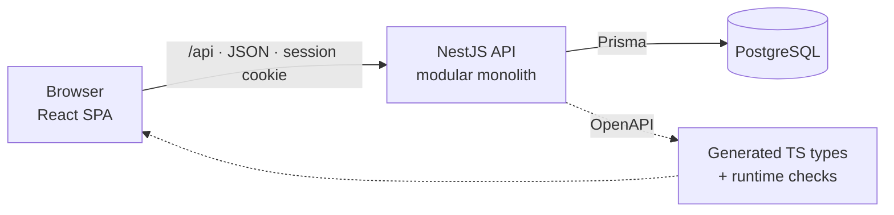

<div align="center">

# Workus

**Day-to-day HR for growing teams** — people, reviews and salaries, time off, a shared calendar
and yearly insights. Multi-tenant: every company's data is its own.


[Quick start](#quick-start) · [Demo accounts](#demo-accounts) · [Features](#features) ·
[Architecture](#architecture) · [Development](#development)

</div>

---

## Quick start

Requires Docker with Compose v2.

```bash
cp .env.example .env                              # set DATABASE_PASSWORD
docker compose up --build                         # db + backend + frontend
docker compose exec backend npm run db:seed       # demo data (once)
```

Open **http://localhost:8080** and sign in with a [demo account](#demo-accounts). Migrations run
on backend start; data lives in the `db-data` volume (`docker compose down -v` removes it).

## Demo accounts

The seed creates two independent companies. Password for every account: **`Workus-Dev-2026!`**
(fictional data, local use only).

| Role | 🏢 OSDB · 46 people | 🌀 Vortex · 9 people |
|---|---|---|
| **Owner** | `sophia.carter@osdb.io` | `liam.foster@vortex.io` |
| **Admin** | `marcus.reid@osdb.io` | `hannah.brooks@vortex.io` |
| **Employee** | `ava.thompson@osdb.io` | `ethan.cole@vortex.io` |

Any other seeded person: `first.last@osdb.io` or `first.last@vortex.io`. For an empty company,
choose **Create a company** on the sign-in page.

## Features

| | Owner | Admin | Employee |
|---|:---:|:---:|:---:|
| **Dashboard** — pending requests, who is out, reviews due, joiners and leavers, birthdays | ✅ | ✅ | — |
| **Dashboard** — own leave balances and requests | — | — | ✅ |
| **Employees** — directory, profiles, hiring, termination, activity history | ✅ | ✅ | — |
| **Reviews** — salary history and rich-text feedback | ✅ | ✅ | — |
| **Requests** — approve, reject, cancel, comment | ✅ | ✅ | — |
| **Time off** — request vacation, sick days and days off | — | — | ✅ |
| **Calendar** — everyone's time off for the month | ✅ | ✅ | ✅ |
| **Insights** — headcount, turnover, tenure, absence, salaries vs last year | ✅ | ✅ | — |
| **Settings** — account, password, sessions, security log | ✅ | ✅ | ✅ |
| **Settings** — company holidays, administrators list | ✅ | ✅ | — |
| **Settings** — rename the company, make owners and admins | ✅ | — | — |

Also: in-app notifications, an append-only change history for every employee, review and request,
light and dark themes, and a responsive layout from phone to desktop.

## Architecture



- **Multi-tenancy.** Every user belongs to one organisation. Each tenant row carries
  `organisation_id`, and composite foreign keys make cross-tenant links impossible in the
  database itself. Every query is scoped, and an id from another company answers like one that
  doesn't exist.
- **Security.**
  - Server-side sessions (HttpOnly cookie, CSRF double-submit, idle and absolute timeouts).
  - Argon2id passwords and rate limits on sign-in and sign-up.
  - Deny-by-default policies that check the whole ownership chain; the app refuses to start if a
    route has no policy.
- **Data integrity.**
  - Optimistic locking and `Idempotency-Key` on side-effecting POSTs.
  - Money as `NUMERIC(19,4)`, never a float.
  - The audit log is written in the same transaction as the change.
- **One contract.** Zod schemas validate input and generate `openapi.json`. The frontend
  generates its types and response validators from it.

### Tech stack

| Layer | Stack |
|---|---|
| Backend | Node.js 26 · TypeScript 6 · NestJS 11 · Prisma 7 · PostgreSQL 18 · Zod 4 · pino |
| Frontend | React 19 · TypeScript 5.9 · Vite 8 · MUI 9 · Tailwind CSS 4 · TanStack Query 5 · React Router · React Hook Form · react-i18next |
| Tooling | ESLint · Prettier · OpenAPI codegen · Docker Compose |

### Repository layout

```
workus/
├── backend/            NestJS API — src/modules/<module>/{controller,service,repository}
│   └── prisma/         schema, SQL migrations (each with down.sql), seed
├── frontend/           React SPA — src/features/<feature> mirrors backend modules
└── docker-compose.yml  local stack: db · backend · frontend (nginx)
```

## Development

Requires Node.js 26 (`.nvmrc` in each package) and PostgreSQL 18 with an empty database.

```bash
# backend — http://localhost:3000 (API docs at /docs)
cd backend && cp .env.example .env    # set DATABASE_* values
npm ci && npm run db:migrate:deploy && npm run db:seed
npm run start:dev

# frontend — http://localhost:5173 (proxies /api to :3000)
cd frontend && cp .env.example .env
npm ci && npm run generate:api
npm run dev
```

### Scripts

| Where | Command | Does |
|---|---|---|
| backend | `npm run start:dev` | API with watch mode |
| backend | `npm run db:migrate:create -- --name <module>_<change>` | New migration (review the SQL) |
| backend | `npm run db:migrate:deploy` · `db:seed` · `db:check` | Apply · seed · schema drift check |
| backend | `npm run openapi:generate` | Write `openapi.json` |
| frontend | `npm run dev` · `build` | Dev server · production build |
| frontend | `npm run generate:api` | Types and validators from `openapi.json` |
| both | `npm run typecheck` · `lint` · `format` | Quality gates |

An API change ships with the regenerated `openapi.json` and frontend types in the same commit.

### Environment

Copy each `.env.example` to `.env` beside it and fill in the blanks.

| File | For | Required |
|---|---|---|
| `.env.example` | Docker Compose | `DATABASE_PASSWORD` |
| `backend/.env.example` | Backend outside Docker | `DATABASE_PASSWORD` |
| `frontend/.env.example` | Frontend build | — |
