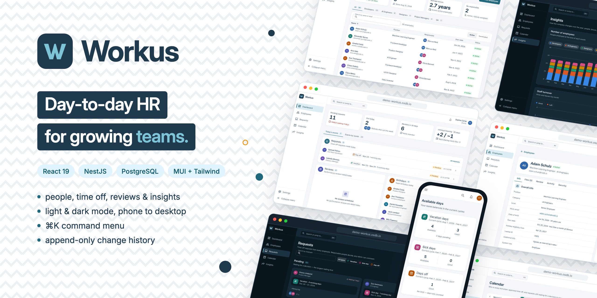
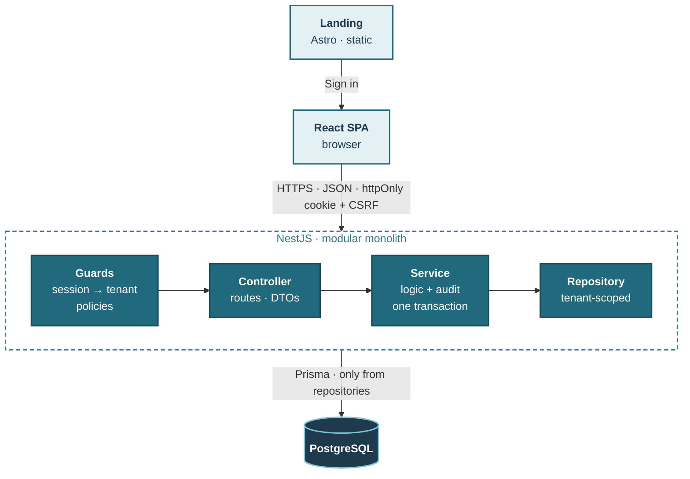

<div align="center">

[](https://demo-workus.osdb.io)

# Workus

**Day-to-day HR for growing teams** — people, reviews and salaries, time off, a shared calendar
and yearly insights. Multi-tenant: every company's data is its own, and a new company goes live
once the Workus team approves it.


<br/>

[](https://demo-workus.osdb.io)

Sign in with any [demo account](#demo-accounts) · password `Workus-Dev-2026!`

<br/>

[Quick start](#quick-start) · [Environments](#environments) · [Demo accounts](#demo-accounts) ·
[Features](#features) · [Architecture](#architecture) · [Development](#development)

</div>

---

## Quick start

Requires Docker with Compose v2. Set `DATABASE_PASSWORD` in `.env` before the first start.

```bash
cp .env.example .env
docker compose up --build -d
docker compose run --rm migrate npm run db:seed
```

Then open **http://localhost:8080** and sign in with a [demo account](#demo-accounts).

- **Public demo mode:** set `DEMO_MODE=true` in `.env` ([Environments](#environments)).
- **Start over:** `docker compose down -v` deletes the data.

## Environments

One build, two modes. `DEMO_MODE` in `.env` switches between them.

| | 💻 Local | 🌐 Demo |
|---|---|---|
| **`DEMO_MODE`** | `false` (default) | `true` |
| **Limits** | None | On the shared demo accounts |
| **Where** | http://localhost:8080 | [demo-workus.osdb.io](https://demo-workus.osdb.io) |

**What the demo blocks** on the shared accounts, so one visitor can't lock out the others:

- changing or resetting passwords;
- changing roles;
- signing out other sessions;
- editing or terminating the shared accounts.

Everything else works. A company you sign up yourself has no limits.

**Fresh every day.** At 08:00 Kyiv time the demo database is reset and seeded again, with a few
new time-off requests waiting for a decision.

## Demo accounts

Two seeded companies and a platform admin, on the **[live demo](https://demo-workus.osdb.io)** or
locally. Every password is **`Workus-Dev-2026!`** (all data is fictional).

| Role | 🏢 OSDB · 46 people | 🌀 Vortex · 34 people |
|---|---|---|
| **Owner** | `sophia.carter@osdb.io` | `liam.foster@vortex.io` |
| **Admin** | `marcus.reid@osdb.io` | `hannah.brooks@vortex.io` |
| **Employee** | `ava.thompson@osdb.io` | `ethan.cole@vortex.io` |

| Workus platform | Account |
|---|---|
| **Platform admin** — approves companies | `admin@workus.io` |

Everyone else signs in as `first.last@osdb.io` or `first.last@vortex.io`. A company you create
with **Create a company** opens once a platform admin approves it.

## Features

| | Owner | Admin | Employee | Platform admin |
|---|:---:|:---:|:---:|:---:|
| **Dashboard** — requests, absences, reviews, birthdays | ✅ | ✅ | — | — |
| **Dashboard** — own balances and requests | — | — | ✅ | — |
| **Employees** — profiles, hiring, termination, activity | ✅ | ✅ | — | — |
| **Reviews** — salary history and feedback | ✅ | ✅ | — | — |
| **Requests** — approve, reject, comment | ✅ | ✅ | — | — |
| **Time off** — vacation, sick days, days off | — | — | ✅ | — |
| **Calendar** — everyone's time off | ✅ | ✅ | ✅ | — |
| **Insights** — headcount, turnover, absence, salaries | ✅ | ✅ | — | — |
| **Settings** — account, sessions, security log | ✅ | ✅ | ✅ | ✅ |
| **Settings** — structure, holidays, administrators | ✅ | ✅ | — | — |
| **Settings** — company name, admins, owners | ✅ | — | — | — |
| **Companies** — approve sign-ups | — | — | — | ✅ |

Also: **⌘K command menu**, notifications, full change history, light and dark themes, mobile layout.

## Architecture

**Request path** — one request, from the browser to the database and back.



1. **Landing.** A static Astro page for signed-out visitors, served at `/`; it never calls the API.
2. **React SPA.** Sends JSON over HTTPS with an `HttpOnly` session cookie and a CSRF token.
3. **Guards.** Find the caller's company from the session and refuse anything their policy doesn't allow.
4. **Controller.** Validates the request with Zod and passes the company id on explicitly.
5. **Service.** Applies the business rules and saves the change with its audit record in one transaction.
6. **Repository.** The only code that queries the database, always filtered by the company.
7. **PostgreSQL.** Composite foreign keys keep companies apart, and the audit table can't be changed.

### Tech stack

| Layer | Stack |
|---|---|
| Backend | NestJS · Prisma · PostgreSQL · Zod |
| Frontend | React · MUI · Tailwind CSS · TanStack Query |
| Landing | Astro (static, zero JavaScript by default) · Tailwind CSS |
| Tooling | TypeScript · OpenAPI · Docker |

### Repository layout

```
workus/
├── backend/            NestJS API — src/modules/<module>/{controller,service,repository}
│   └── prisma/         schema, SQL migrations (each with down.sql), seed
├── frontend/           React SPA — src/features/<feature> mirrors backend modules
├── landing/            Astro site — the public page at a signed-out `/` (SEO, share image, sitemap)
└── docker-compose.yml  local stack: db · migrate · backend · frontend (nginx)
```

## Development

Requires Node.js 26 and PostgreSQL 18 with an empty database.

**Backend** — http://localhost:3000, API docs at `/docs`. Set `DATABASE_*` in `.env` first.

```bash
cd backend && cp .env.example .env
npm ci && npm run db:migrate:deploy && npm run db:seed && npm run start:dev
```

**Frontend** — http://localhost:5173, proxies `/api` to the backend.

```bash
cd frontend && cp .env.example .env
npm ci && npm run generate:api && npm run dev
```

**Landing** — http://localhost:4321.

```bash
cd landing && npm ci && npm run dev
```

### Scripts

Every package has `build`, `typecheck`, `lint` and `format:check`. The backend adds:

| Script | Does |
|---|---|
| `db:migrate:create` | Creates a SQL migration |
| `db:migrate:deploy` | Applies migrations |
| `db:seed` | Loads the demo data |
| `db:demo-reset` | Wipes and reseeds (demo mode only) |
| `openapi:generate` | Writes `openapi.json` |

**Changing the API:** run `openapi:generate` in the backend and `generate:api` in the frontend, then commit both.

### Configuration

| File | Used by | Fill in |
|---|---|---|
| `.env` | Docker Compose | `DATABASE_PASSWORD` |
| `backend/.env` | Backend without Docker | `DATABASE_*` |
| `frontend/.env` | Frontend build | Nothing |

`DEMO_MODE=true` in `.env` or `backend/.env` turns on the [demo limits](#environments).
