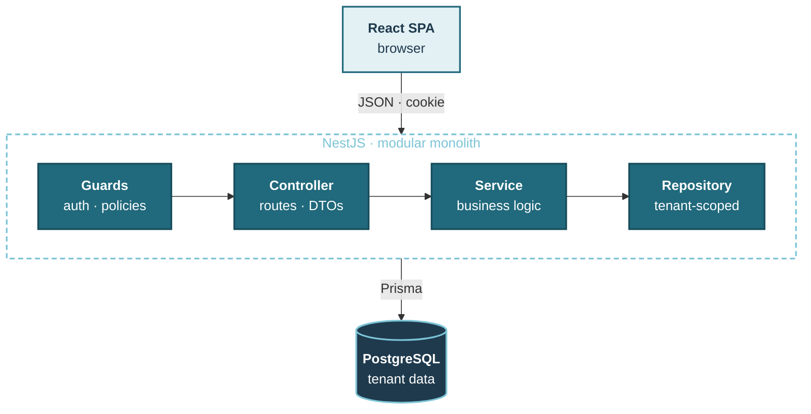
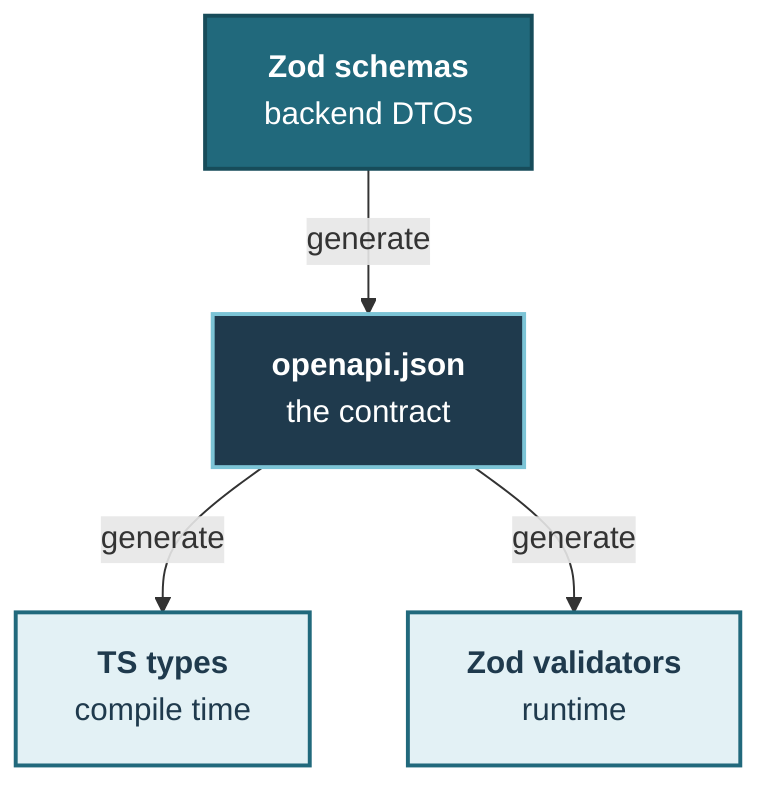

<div align="center">

[](https://demo-workus.osdb.io)

# Workus

**Day-to-day HR for growing teams** — people, reviews and salaries, time off, a shared calendar
and yearly insights. Multi-tenant: every company's data is its own, and a new company goes live
once the Workus team approves it.


<br/>

[](https://demo-workus.osdb.io)

Sign in with any [demo account](#demo-accounts) · password `Workus-Dev-2026!`

<br/>

[Quick start](#quick-start) · [Environments](#environments) · [Demo accounts](#demo-accounts) ·
[Features](#features) · [Architecture](#architecture) · [Development](#development)

</div>

---

## Quick start

Requires Docker with Compose v2.

```bash
cp .env.example .env                              # set DATABASE_PASSWORD
docker compose up --build                         # local — no limits
DEMO_MODE=true docker compose up --build          # …or run it as the public demo
docker compose run --rm migrate npm run db:seed  # demo data (once)
```

Open **http://localhost:8080** and sign in with a [demo account](#demo-accounts). The `migrate`
service applies migrations before the backend starts; data lives in the `db-data` volume
(`docker compose down -v` removes it).

## Environments

One build, two modes — switched by `DEMO_MODE` on the backend.

| | 💻 Local | 🌐 Demo |
|---|---|---|
| **Run** | `docker compose up` | `DEMO_MODE=true docker compose up` |
| **`DEMO_MODE`** | `false` (default) | `true` |
| **Limits** | None — every action works | Shared accounts stay usable (below) |
| **Seen at** | http://localhost:8080 | [demo-workus.osdb.io](https://demo-workus.osdb.io) |

In demo mode the API answers `403 DEMO_RESTRICTED` and the UI hides the action — so one visitor
cannot lock the others out:

- changing your password, resetting an employee's, changing admin ↔ owner roles;
- signing out other sessions (they belong to other visitors);
- editing or terminating the showcase accounts listed in `DEMO_PROTECTED_EMAILS`.

Everything else — hiring, reviews, requests, comments, holidays — works as usual.

The live demo starts each day afresh: at 08:00 Kyiv time its database is wiped and seeded again
for that day (`npm run db:demo-reset` — refuses to run without `DEMO_MODE=true`), so what visitors
entered is gone and every company has a few sick-leave and vacation requests made that morning,
waiting for a decision.

## Demo accounts

Try them on the **[live demo](https://demo-workus.osdb.io)** or locally — the seed creates two
independent companies and a Workus platform admin. Password for every account:
**`Workus-Dev-2026!`** (fictional data).

| Role | 🏢 OSDB · 46 people | 🌀 Vortex · 34 people |
|---|---|---|
| **Owner** | `sophia.carter@osdb.io` | `liam.foster@vortex.io` |
| **Admin** | `marcus.reid@osdb.io` | `hannah.brooks@vortex.io` |
| **Employee** | `ava.thompson@osdb.io` | `ethan.cole@vortex.io` |

| Workus platform | Account |
|---|---|
| **Platform admin** — approves companies | `admin@workus.io` |

Any other seeded person: `first.last@osdb.io` or `first.last@vortex.io`. **Create a company** on
the sign-in page registers a new one — it opens after a platform admin approves it.

## Features

| | Owner | Admin | Employee | Platform admin |
|---|:---:|:---:|:---:|:---:|
| **Dashboard** — pending requests, who is out, reviews due, joiners and leavers, birthdays | ✅ | ✅ | — | — |
| **Dashboard** — own leave balances and requests | — | — | ✅ | — |
| **Employees** — directory, profiles, hiring, termination, password reset, activity | ✅ | ✅ | — | — |
| **Reviews** — salary history and rich-text feedback | ✅ | ✅ | — | — |
| **Requests** — approve, reject, cancel, comment | ✅ | ✅ | — | — |
| **Time off** — request vacation, sick days and days off | — | — | ✅ | — |
| **Calendar** — everyone's time off for the month | ✅ | ✅ | ✅ | — |
| **Insights** — headcount, turnover, tenure, absence, salaries vs last year | ✅ | ✅ | — | — |
| **Settings** — account, password, sessions, security log | ✅ | ✅ | ✅ | ✅ |
| **Settings** — company holidays, administrators list | ✅ | ✅ | — | — |
| **Settings** — rename the company, add admins, make owners | ✅ | — | — | — |
| **Companies** — approve sign-ups, see each company's people (directory only) | — | — | — | ✅ |

Also: a **⌘K command menu** (pages, settings, people, theme), in-app notifications, an
append-only change history for every employee, review and request, light and dark themes, and a
responsive layout from phone to desktop.

## Architecture

**Request path** — every call passes the guards, then flows down the layers, scoped to the
caller's organisation.



**One contract** — the API is described once, in Zod; the frontend never hand-writes an API type.



### Engineering guarantees

| Concern | Guarantee | Enforced by |
|---|---|---|
| **Tenancy** | No cross-company access | `organisation_id` · composite FKs |
| **Platform admins** | Never see company data | Policy scope checked by one guard |
| **Approval** | Nothing opens before approval | Company status in the session |
| **Authorisation** | Deny by default | Policy on every route, checked at boot |
| **Sessions** | Instant revocation | Server-side sessions · CSRF |
| **Passwords** | Never in plain text | Argon2id · shown once |
| **Retries** | No double POSTs | `Idempotency-Key` |
| **Concurrency** | No lost updates | Optimistic locking · row locks |
| **Money** | Exact | `NUMERIC(19,4)` · `Decimal` |
| **Audit** | Full, permanent history | Same transaction · append-only |
| **Public demo** | No visitor locks others out | `DEMO_MODE` guard · hidden in UI |
| **API contract** | No client–server drift | OpenAPI → generated types |

**Trade-offs, on purpose**

- **Tenant from the session, not the URL** — a user belongs to one company, so URLs stay clean;
  every id in a path is still checked against the caller's company.
- **Polling, not WebSockets**, for notifications (60 s) — no extra infrastructure for an HR cadence.
- **No automated tests yet** — invariants live in types, database constraints and startup checks;
  tenant isolation is verified with scripted API runs. Policies are the first thing to cover.

### Tech stack

| Layer | Stack |
|---|---|
| Backend | NestJS · Prisma · PostgreSQL · Zod |
| Frontend | React · MUI · Tailwind CSS · TanStack Query |
| Tooling | TypeScript · OpenAPI · Docker |

### Repository layout

```
workus/
├── backend/            NestJS API — src/modules/<module>/{controller,service,repository}
│   └── prisma/         schema, SQL migrations (each with down.sql), seed
├── frontend/           React SPA — src/features/<feature> mirrors backend modules
└── docker-compose.yml  local stack: db · migrate · backend · frontend (nginx)
```

## Development

Requires Node.js 26 (`.nvmrc` in each package) and PostgreSQL 18 with an empty database.

```bash
# backend — http://localhost:3000 (API docs at /docs)
cd backend && cp .env.example .env    # set DATABASE_* values
npm ci && npm run db:migrate:deploy && npm run db:seed
npm run start:dev                     # local · DEMO_MODE=true npm run start:dev → demo

# frontend — http://localhost:5173 (proxies /api to :3000)
cd frontend && cp .env.example .env
npm ci && npm run generate:api
npm run dev
```

### Scripts

Run with `npm run <script>` inside the package.

| Task | `backend/` | `frontend/` |
|---|---|---|
| **Develop** | `start:dev` | `dev` |
| **Build** | `build` | `build` |
| **Check** | `typecheck` · `lint` · `format:check` | `typecheck` · `lint` · `format:check` |
| **Database** | `db:migrate:create` · `db:migrate:deploy` · `db:seed` · `db:demo-reset` | — |
| **Contract** | `openapi:generate` · `openapi:check` | `generate:api` |

**Changing the API:** `openapi:generate` → `generate:api` → commit both with the change.

### Configuration

Copy each `.env.example` to `.env` beside it and fill in the blanks.

| File | For | Required | Demo mode |
|---|---|---|---|
| `.env.example` | Docker Compose | `DATABASE_PASSWORD` | `DEMO_MODE` · `DEMO_PROTECTED_EMAILS` |
| `backend/.env.example` | Backend outside Docker | `DATABASE_PASSWORD` | `DEMO_MODE` · `DEMO_PROTECTED_EMAILS` |
| `frontend/.env.example` | Frontend build | — | — (read from the API) |
